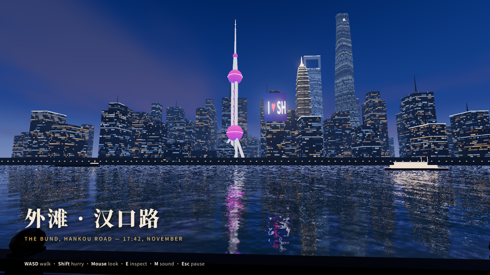

# 回潮 Returning Tide — milestone 2: Two People on the Waterfront

First playable slice of a contemporary Shanghai RPG. First-person, blue hour, just after rain:
one short street (Hankou Road), ~155 m of the Bund promenade with two conversing residents, and Pudong across the Huangpu as scenery.



## Run

```bash
npm install
npm run dev        # http://localhost:5173
```

`npm run build && npm run preview` serves the production build on :4173.
Needs a desktop browser with WebGL2, a keyboard and a mouse.

## Controls

| | |
|---|---|
| W A S D / arrows | walk |
| Shift | hurry |
| Space | jump (a short hop; barriers stay solid) |
| Mouse | look (click the page to capture the pointer) |
| E | read notice / greet NPCs / step back |
| C | Simplified Chinese subtitles on / off |
| M | sound on / off |
| Esc | pause / step back from dialogue (click to return) |

## What is here

- Walk from Hankou Road out onto Zhongshan East 1st Road, up the stair, along the promenade.
- Barriers at both ends of the waterfront and a hoarding at the west end of Hankou Road mark the edges.
- Missing-person notice taped to a lamp post by the river hinting at Mission One.
- Two waterfront NPCs (`老林` / Old Lin and `苏女士` / Ms. Su) standing near the river railing beneath a promenade lamp, already conversing in Mandarin across three everyday-Shanghai exchanges with idle/listening/speaking gestures, non-repeating cadence, and a brief greeting interaction (`E`).
- Audio & speech note: recorded Mandarin/Shanghainese voice clips are not yet shipped, so `src/engine/dialogueAudio.js` implements WebAudio `PannerNode` positional attenuation ready for recorded clips and falls back to browser Mandarin speech synthesis (`window.speechSynthesis`, `zh-CN`), clearly labeled in the subtitle bar. Browser `speechSynthesis` playback requires an OS/browser `zh-CN` TTS voice and uses utterance-start scalar distance volume rather than true binaural panning.

## Layout of the code

```
src/main.js            boot, mode switching (entry / play / inspect / dialogue / pause), frame loop
src/engine/            renderer + quality ladder, player input, movement + collision, audio, conversation + dialogueAudio
src/world/layout.js    every position, collider, NPC placement and ground-height function (single source of truth)
src/world/*.js         one module per part of the scene: sky, skyline, river, bund, promenade, street, lighting, clue, npcs
src/world/text.js      all in-world Chinese text and NPC dialogue lines (also drives webfont preloading)
src/ui/                HUD and stylesheet
tests/                 node tests for movement, collision, boundaries and conversation state (npm test)
tools/                 headless screenshot / playtest / render-cost scripts (need Playwright installed globally:
                       NODE_PATH=$(npm root -g) node tools/playtest.mjs)
```

Everything is procedural (canvas textures, merged box/cylinder geometry, WebAudio synthesis; temporary Mandarin speech synthesis fallback for NPC lines).
The only third-party assets are three.js and three open-licensed fonts from Fontsource
(Noto Serif SC, Noto Sans SC, Ma Shan Zheng).

Useful URL switches: `?q=0..5` pins the render quality step (0 = best), `?nolock` uses
click-drag look instead of pointer lock, `?subs=0` starts with subtitles off.
