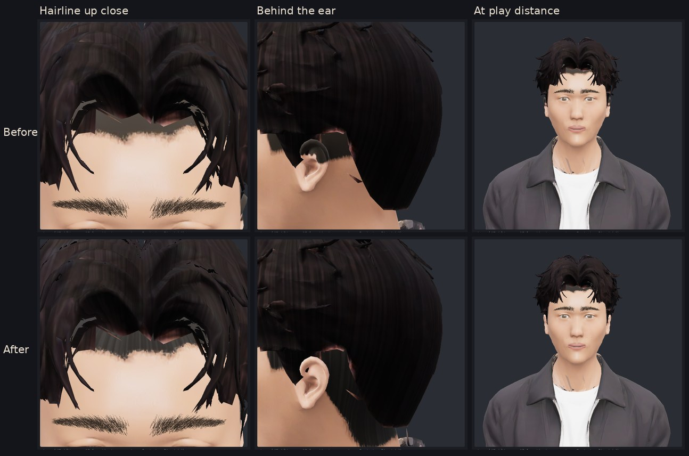
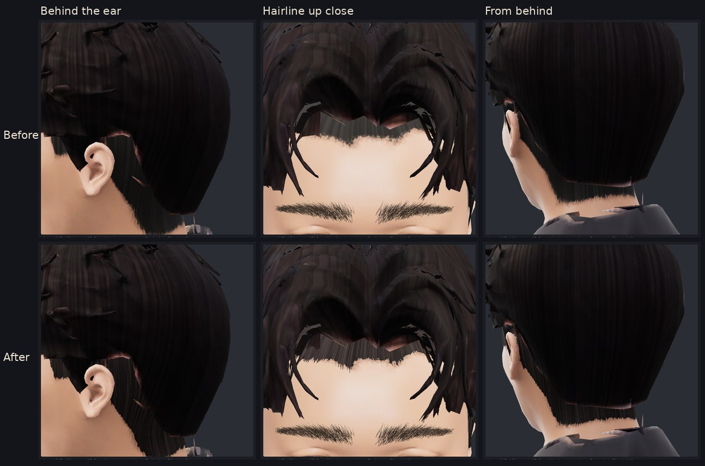
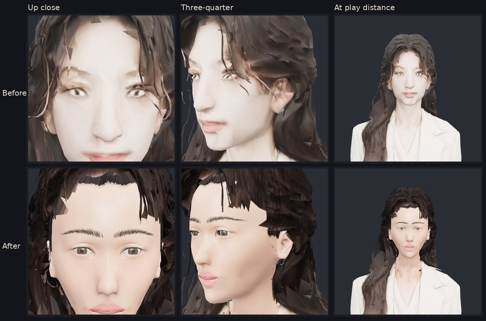
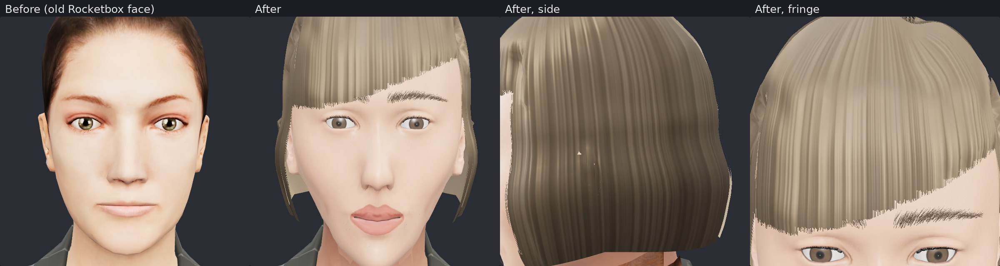
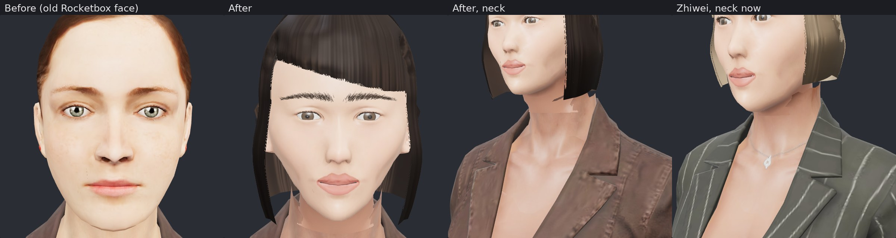
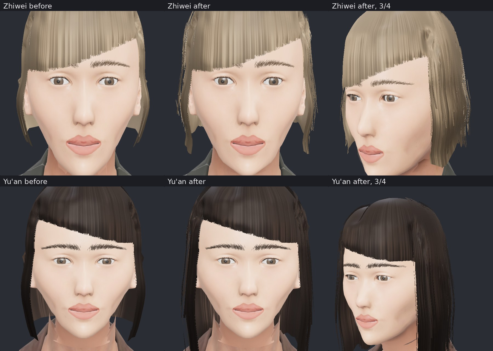
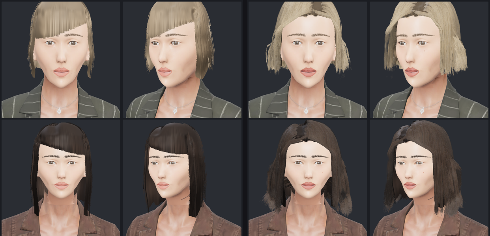

# Close-up faces for the main characters

*Started 25 November 2026. The pipeline: `tools/characters/` (README there). The reasoning and budgets:
`docs/research-hero-characters.md`. Who these people are: `docs/characters.md` and the Character Bible.*

## Where it stands

- **Pipeline step 0 is running in the cloud**: Blender 5.3 as a Python module with MPFB2 2.0.18, driven by a JSON
  character sheet (`tools/characters/sheets/<id>.json`), producing Cycles close-ups and a head GLB, plus a three.js
  review page (`tools/characters/review.html`) with dialogue cameras, game-like light and face-shape sliders.
- **Ji Bai, prototype v1** (`sheets/jibai.json`): 180 cm, the face fitted by eye to `docs/jibai-reference.webp`,
  own eyes, brows, lashes, hair cards and 34 face shapes. Every slider is a guess; nothing is LOCKED.
- **Not reachable from the cloud machine:** MPFB's asset packs on static.makehumancommunity.org (skins, hair,
  eyes, the 52 ARKit face units, visemes). The build works without them; with them (on the owner's Mac, or if the
  host is allowed) the face shapes become the real ARKit 52 and lip sync gets its visemes.

## Order of the cast

Who gets a close-up head, in the order the camera needs them. Bodies stay what they are today until each head is
approved (Ji Bai's and Gu Nian's Hunyuan bodies, Rocketbox for the rest); the head is a separate mesh by design.

| # | Who | Reference | Why this order | Notes for the sheet |
|---|---|---|---|---|
| 1 | P01 Ji Bai | `docs/jibai-reference.webp` | mirrors, cutscenes, the character page | black, full, slightly wavy hair over the forehead (LOCKED); clean-shaven, defined jaw |
| 2 | F03 Gu Nian | `docs/gunian-reference.webp` | already has her own body; most dialogue among the five | long dark-brown wavy hair (the hardest groom); pearl earrings |
| 3 | F01 Xu Zhiwei | `docs/zhiwei-reference.jpg` (approved face) | his first engagement, every workday | short ash-blonde layered hair with dark roots; thin silver glasses (a separate mesh) |
| 4 | F04 Lin Yu'an | `docs/yuan-reference.jpg` (approved face) | oldest friend and a romance lead; in the most scenes of the six | shoulder-length dark hair with a slight wave; thin metal glasses |
| 5 | Ji Jianguo (father) | none yet | the final dinner at the Peace Hotel is the game's last close-up | needs an approved face first (OPEN) |
| 6 | F02 Shen Nanxing | none approved | romance lead | dark, full, short curly hair (LOCKED); face OPEN |
| 7 | F05 Tang Kexin | none approved | romance lead | the pink sporty look (LOCKED); face OPEN |
| 8-11 | Lu Mingxuan, Zhou Zimo, Han Zhixia, Cheng Yinuo | none approved | the friends; medium shots more than close-ups | could stay at 1.5-3 m quality (MPFB without the extra passes) |

Faces still OPEN in the Bible (Nanxing, Kexin, the father, the friends) need an approved portrait (front, three
quarter, profile) before a sheet is worth fitting: the owner picks, then an agent fits sliders to it.

## What each head needs after v1 (the human-eye passes)

1. **Likeness:** the owner compares the renders with the reference and says what is off (jaw, eyes, nose, lips);
   an agent moves the sliders. KeenTools FaceBuilder (~$18/month) if sliders can't get there.
2. **Skin (research step 3):** project the chosen portrait onto the head's UVs, a normal map and a roughness map,
   AO and cavity. v1 has procedural colour only (and only the colour reaches the GLB).
3. **Hair (step 4):** v1's cards are grown by a flow field; a person has to groom the silhouette.
4. **Eyes:** a painted iris, a tear line, an occlusion shell.
5. **Face shapes:** swap the 34 MakeHuman units for MPFB's `faceunits01` (52 ARKit) and add `visemes02`
   for lip sync (step 7), from the owner's Mac where the packs download.
6. **Export (step 8):** meshopt (gltfpack) and KTX2 textures; a shared skeleton with the body.

## Budgets (from the research doc) against Ji Bai v1

| | budget | v1 |
|---|---|---|
| head mesh | 8-12k triangles | 8.6k |
| hair | 5-12k | 10.2k (640 cards) |
| brows + lashes | (head budget) | 4.6k + 1.3k: brows could halve |
| eyes, mouth | | 2 × (0.95k ball + 0.95k cornea), 0.6k teeth and tongue |
| face shapes | head-only mesh | 34 on the 8.6k head |
| all of the head | 25-40k with the body | 29.2k (head only; the body is not built yet) |
| GLB | ≤ 5-8 MB per hero | 1.3 MB for the head, before meshopt and KTX2 |

Renders: `docs/hero-faces/jibai-v1-renders.jpg` (Cycles, with the reference), `jibai-v1-threejs.jpg` (the GLB in
the review page, Bund-at-dusk light, smiling). The GLB: `public/people/jibai/head.glb` (not used by the game yet).

## Ji Bai v1: honest read

- Close to the reference: the hair colour and fringe direction, brown eyes looking straight through the lids, a
  clean-shaven skin tone, a working set of face shapes (blinks, smile, jaw, brows) in Blender and in three.js.
- Off: the face is softer and wider than the sheet (the jaw needs more angle, the cheeks less fullness), the lips are
  pale and a little full, the skin is plastic (no texture pass yet), the hair is a dense mop of visible cards rather
  than the sheet's soft tousled volume, and the fringe hides most brow movement.
- Fixed on the way: MPFB's expression units load ten times too strong onto a baked mesh unless its scale factor
  (0.1) is set; the build sets it.

## Ji Bai v2 (round 2, 25 November)

- **Changed:** a narrower face tapering to the chin, higher cheekbones, a longer and narrower nose, larger eyes set
  higher with the outer corners lifted, brows lower and finer, smaller and darker lips; warmer skin with cheek and
  nose warmth and under-eye shadow; the GLB now carries baked normal (pores) and roughness maps as well as colour;
  the hair has a parting with the fringe falling away from it, wider front cards, less lift and less shine.
- **Renders:** `docs/hero-faces/jibai-v2-renders.jpg` (with the reference), `jibai-v2-threejs.jpg`.
- **Most useful next steps:** a person's notes on the likeness; a portrait projection onto the head's UVs (research
  step 3) for the skin; the `faceunits01` and visemes packs from the owner's Mac; a head for an NPC who really
  has dialogue close-ups (Gu Nian first).

## In the game (round 3, 25 November)

- **Ji Bai's body now wears the MPFB face** (`people.json` `head` + `keepHair`, `swapHead` in `src/world/people.js`).
  Only the skin of the Hunyuan head goes: its sculpted hair stays (it reads far better than v2's cards), and the
  face, ears and neck come from `jibai/head.glb` with its eyeballs, brows, upper lashes and 34 face shapes. The
  head is placed by the nose tip (the front-most skin-coloured point, so a fringe can't win), scaled to the old
  face's nose-to-chin length and mouth-level width (the Hunyuan faces are smaller under a larger skull: Ji Bai's
  comes out at 0.84, and deepened to fill the hair shell), skinned to the body's Head and Neck bones, the new skin
  stopping 3 cm under the chin where the old neck takes over, and tinted to the body's skin from the texture.
  Brows and lashes are matte (their grazing edges caught the sky as white fuzz). The first-person body hides it.
- **v3 sheet:** v2 plus a flatter, wider, less pink mouth (v2's read as pursed). Every slider is still a guess.
- **Gu Nian keeps her own face, repaired.** An MPFB face on her body (`sheets/gunian.json`) looked less like her
  than her own texture, so instead `tools/characters/repair_eyes.py` rewrote her smeared right eye and brow from
  her good left eye, mirrored across the face and feathered into the skin, and flattened the baked normal noise
  over both eyes. Strands of hair over the face are left alone. `docs/hero-faces/gunian-eye-repair.jpg`; both faces before and after in the game's renderer:
  `docs/hero-faces/faces-before-after.jpg`.
- **Every Rocketbox NPC's hair** lost its grey slabs: the hair cards were catching specular at grazing angles;
  `fixHair` gives them a matte physical material with alpha to coverage (`p5`'s blonde also gets a warmer tint).
- **Check it:** `/tools/characters/faces.html` (every face at dialogue distance in the game's renderer and idle
  pose; `?roles=player,gunian&yaw=40`, `swap=0` for the original head, `keephair=0` for the MPFB hair cards).
- **Still off:** a patchy seam on Ji Bai's neck where the new skin meets the old (in shadow under the jaw in the
  game, visible in the review page's studio light); Ji Bai's skin is as pale as his Hunyuan body and plain next to the AI portraits (no portrait
  projection yet); the brows are a little stripy close up; Gu Nian's texture is low resolution around the eyes
  and slightly smudged at the lips; her MPFB sheet needs a likeness pass before it is worth another try.

## Round 4 (25 November): neck, skin tone, NPC hair

- **Ji Bai's neck:** the new head's neck now takes the shape of the old neck it replaces (`conformNeck`: stretched
  down to where the old neck skin ended, then each half-centimetre slice moved and scaled to the old slice), and
  the old neck skin goes entirely. No more patchwork of two skins under the jaw, and nothing pokes through the
  jacket.
- **Ji Bai's skin:** tinted to a tone measured from his portrait (`people.json` `skinTone`, sRGB of the lit cheek
  as the game renders it: `[120, 80, 64]`), not to the pale Hunyuan body; the build now bakes ambient occlusion
  into the skin colour (eye sockets, nostrils, mouth corners, under the jaw); finer brows (density 0.7,
  thickness 0.6). His hands are still the paler Hunyuan skin.
- **NPC hair (all Rocketbox avatars):** the hair painted on the scalp under the cards is part of the glossy head
  material, which made grey shiny streaks between the dark matte cards. `fixHair` now gives each head material a
  roughness and specular map from its own texture: matte where it's dark (hair), unchanged on skin. Su's and
  c5's cards are lightened to match their scalp colour (`hairTint`).
- Before and after: `docs/hero-faces/round4-before-after.jpg`.

## Round 5 (25 November): hands and Su's crown

- **Ji Bai's hands** take the face's tone: with `skinTone` set, `swapHead` recolours the skin texels of his body's
  colour map (warm and light, not hair or cloth) from the old face's mean to the same tone, in linear light.
- **Hair cards on every Rocketbox avatar** are lit as facing outward: normals point away from the middle of the
  head, and the back-face flip is off for them. Cards wound inward used to be lit as facing into the head and
  showed as near-black slabs with hard edges (Su's crown). The su/c5 card lightening of round 4 is gone.
- `docs/hero-faces/round5-hands-crown.jpg`.

## Round 6 (25 November): the specks on Ji Bai's trousers

- **Most of the specks were his hands.** The shared idle pose was made for the slimmer Rocketbox bodies; on the
  Hunyuan bodies the hands hung inside the wide trousers and the arms inside the jacket, and the skin showed
  through the cloth as light shards on the thigh. `people.json` `armOut` (degrees) hangs the arms that much
  wider over whatever the mixer plays (`spreadArms` in `src/world/people.js`, in `createPerson`, the first-person
  body and `faces.html`): Ji Bai 7, Gu Nian 6.
- **The rest were light shards in the bake:** triangles whose UVs fall across an island's edge onto skin or shirt
  texels. `"cleanSpecks": true` recolours, at load, a triangle that is lighter than dark neighbours that agree with
  each other (about 270 on Ji Bai), using a neighbour's UV. Only light-on-dark: the white hem one triangle wide stays.
- `faces.html` debug views for this: `armout=<deg>`, `specks=0|1`, `uvdbg=1` (UV as colour), `tridbg=1`
  (triangle ids). `docs/hero-faces/round6-trousers.jpg`.
- **Still off:** a few faint grey facets on the trousers (shading, not texture), and a dark scratch on his left wrist
  that is painted into the Hunyuan texture.

## Round 7 (25 November): seam cracks on the Hunyuan bodies

- **The wrist "scratch" and the faint grey trouser marks were cracks.** The Hunyuan bodies were rigged per vertex,
  and the copies of a vertex on either side of a UV seam got different skin weights. Posed, the seams opened into
  hairline cracks, and the background showed through them: a dark curve across Ji Bai's left wrist, dotted lines
  down his arms and Gu Nian's suit, and grey marks on his trousers. With `cleanSpecks`, `weldSkin` gives every copy
  of a position the same merged weights at load. Gu Nian now has `cleanSpecks` too.
- How it was found: `faces.html?ids=map` showed the scratch in the scene's background colour, and `tridbg=1` showed
  no triangle there. New in `faces.html`: `aimx` (aim sideways) and `nonormal=1` (the body's normal map off).
- `docs/hero-faces/round7-seams.jpg`.

## Round 8 (25 November): Ji Bai's mouth

- **What was wrong:** the lips were nearly skin-coloured with a soft, blurry border, the mouth stood slightly open
  with a white slit of teeth, and there was no lip line or corner shading, so the mouth read as a pale pout.
- **The sheet's `rest_face`** mixes face shapes into the head's basis (and every face shape alike), so the
  relaxed pose becomes the new zero: `mouthPress 0.25, mouthShrugLower -0.4` closes the lips.
- **The lips** use MPFB's lips group shrunk by one ring of vertices (the group ran into the skin), thresholded for
  a crisp vermilion border, with a darker upper lip (`skin.lips_upper`) than lower (`skin.lips`), dusky rose
  rather than pink, as in his portraits. A per-vertex darkening adds the line where the lips meet, shadowed
  corners, a shadow under the lower lip and the philtrum's groove (`mouth_detail` in `build_hero.py`). The teeth
  are darker, because they sit in the mouth's shadow.
- `docs/hero-faces/round8-mouth.jpg`. **Still off:** a grey fleck of tooth at each corner up close.

## Round 9 (25 November): the flecks at the corners of Ji Bai's mouth

- **What they were:** not teeth at first. MakeHuman's lips roll in at each corner in a tiny ledge that faces the
  light and showed as a pale fleck. Darkening its colour did nothing, because the fleck was lighting, not colour.
- **The ledge** is ironed out with a few Laplacian passes over the front of the corners (`smooth_corners` in
  `build_hero.py`, the same shift in every face shape). That opened a small gap at each corner, and through it:
  - **the side teeth**, which mirrored the sky even when dark. `swapHead` now gives the teeth a low-specular
    material that darkens towards the sides (the side teeth sit in the cheeks' shadow), and the sheet narrows
    them (`teeth_width 0.8`) and sets them back slightly (`teeth_back`).
  - **the back of the head**: MakeHuman's head has no inside to the mouth. `swapHead` adds a dark shell behind the
    teeth (`hero-mouth`, only its far side drawn).
- **Also fixed:** the skin tint (a multiplier on the skin map) was overwriting the tongue's colour, turning it
  white. Only meshes with a map are tinted now.
- **Debug:** in `faces.html`, `morph=jawOpen:0.3,mouthSmile:0.7` sets face shapes and `names=1` lists the meshes
  with their colours.
- `docs/hero-faces/round9-mouth-corners.jpg`.
- **Still off (not seen in play):** with the mouth open, as in a big smile, the tongue sits in front of the upper
  teeth and the teeth are blocky. The game never opens the hero head's mouth (`face.js` drives the body's jaw bone,
  not face shapes), so this only shows in the review renders.

## Round 10 (25 November): lower lip corners, brows, lashes, hair

- **Lower lip corners:** a brown bracket round each end of the lower lip. Round 9's mouth-wall shading darkened
  anything more than 11 mm behind the lips, and the face curves back that far outside the corners. It now only
  shades surfaces that don't face forward. The corner dimple is smaller, the skin crease below each end is
  smoothed (`smooth_lower_corners`), and the lip border is a little softer (mask 0.3 to 0.7).
- **Brows:** they read as hard black combs. Now about 2.5 times as many hairs, finer (0.13 to 0.19 mm) and
  shorter, at uneven angles. The hairs above and below the centre line knit together, and they thin out at the
  edges and at the head and tail. Dark brown rather than black (`brows` in the sheet).
- **Lashes:** they grew from MakeHuman's lash helper, which sits a few millimetres up the lid, so they stood on top
  of it. Now they root on the lid margin itself, found by casting rays from the front for where the skin starts
  to cover the eyeball (`lid_margins`). They leave the edge forward, curl up, fan out towards the outer corner,
  and are longest in the outer third.
- **Eyes:** the sclera is less white, darker towards the corners, and shaded under the upper lid.
- **Hair:** the kept Hunyuan hair shell is split off the body into its own mesh (`kept-hair`) with a strand
  material (`strandHair` in people.js):
  - Strands radiate from the crown, with light and dark hairs in the colour and rougher and smoother ones.
    Each octave fades out once it is finer than about two pixels, so the hair doesn't sparkle at a distance.
  - The highlight is a Kajiya-Kay band across the strands, from the key light. There is little other specular,
    and the colour is a cooler, near-black brown.
  - Where the shell is seen edge on, strand-shaped gaps break the outline into hair tips.
  - It is one extra draw call, with no new textures. The first-person body hides it, like the hero head.
- `docs/hero-faces/round10-brows-lashes-hair.jpg`.
- **Still off:** the hairline. The skin shows as a flat patch between the fringe locks, where the old hair shell
  stops above the new forehead.

## Round 11 (25 November): the hairline

- **What was wrong:** a flat, pale band of skin between the fringe's locks, with a straight edge. The new head
  did have a dark scalp there, but two things made it read as skin:
  - The skin-tone match multiplied the whole face map by about 2, so the scalp was lifted too.
  - The scalp kept the skin's sheen.
- **Now:** `skinToned` (people.js) tones only the skin texels and leaves dark ones alone: the scalp and the
  mouth's inside. In `build_hero.py` the scalp is the hair's own near-black and matte. The front hairline is
  soft (about 10 mm), uneven, and broken into wisps and roots by stretched noise in the shader.
- `docs/hero-faces/round11-hairline.jpg`.

## Round 12 (25 November): gaps under Ji Bai's hair

- **Why it looked hollow, and why a band showed under the fringe:** his kept Hunyuan hair is a sculpted shell that floats a little off the head and was drawn one-sided. Under its edges you saw the MPFB scalp (a flat, matte grey-brown under the lights), bare skin behind the ear, and through its open edges into nothing.
- **Fixes:** the scalp texels of the hero skin get the same crown-radial strand shading as the shell (`strandPatch` in people.js, darker, as hair lying flat under other hair would be), so the gap reads as short hair down to the painted hairline. The shell is drawn double-sided with a dark inside. In build_hero.py the hairline no longer paints hair on the ears (it made a black cap on the ear top) and runs behind the ear from mid-ear curving down to the nape, with a soft uneven edge.

## Round 13 (26 November): short hair with depth instead of paint

- **Painted hair read as a black stain on the skin** (behind the ear, the nape, the band under the fringe). It is now shell fur (`furShells` in people.js): the head's scalp triangles copied in 12 layers lifted about 3 mm off the skin and combed about 7 mm down along the hair's fall. A pixel survives on a layer only inside a strand (about 1 per mm) long enough to reach it, and strands taper. Where hair grows is read per pixel from the painted scalp, so the hairline does not step along the triangles. The face's own dark texels (lids, lip line) are excluded by position.

## Round 14 (26 November): Gu Nian gets the close-up head

- **Her head is now built by build_hero.py** (sheet v2) and swapped onto her Hunyuan body with her own hair kept, as Ji Bai's is: clean lips with her rose colour, fine arched brows, fuller lashes on the lid margin, warm skin from her portrait.
- **New sheet controls** for women and other hair: `hairline` (`lift_m`, `recede`, `temple_rise`: a high, rounded hairline without a man's receding temples), `brows` (`arch_m`, `tail_drop_m`, `raise_m`), `lashes` (`count`, `length`, `width`).
- **people.json per character:** `hairLum` (her brown hair's lit locks are lighter than Ji Bai's black: kept as hair, with the old painted skin inside those triangles cut away per pixel) and `conformNeck: false` (her open collar: the stretched neck folded into shards over a ragged old neck, so the new neck keeps its shape over the old neck left under its end, and its last centimetres take the old neck's colour).
- **retintBodySkin** skips near-white warm cloth (her cream blouse and jacket had turned pink).
- Still to improve: her kept hair's front edge is cut straight across the forehead (the Hunyuan shell), and the neck join is faintly visible up close.

## Round 15 (26 November): Xu Zhiwei gets her own head and a bob

- **Her own role** (`zhiwei` in people.json) on the Business_Female_04 body, which she used to share with street NPCs. Its old face and ponytail are gone: a Rocketbox body is split into nine primitives, and each one loses the triangles skinned to the head bones and every bone under them.
- **A generated hair shell** for a cut the old body never had (sheet hair `style: "shell"`, `hair_shell()` in build_hero.py): the scalp pushed out by the hair's thickness, hanging straight below the head's widest ring, a skirt to the cut with a soft belly and tuck, kept clear of the ears, open over the face (`face_open_deg`). The swept fringe (`fringe_sweep`) runs from low over one brow up to the parting. Its edge follows that line instead of the grid's steps: the boundary vertices are moved onto it, and steep parts are filled with fans. In the game it gets the same strand shading as kept hair, darker roots, and its lower and open edges break into uneven tips (`hairShellMaterial`).
- **Neck:** with `conformNeck: false` on a Rocketbox body, the new neck below the chin is dropped and her old neck meets the new jaw. The rest of the new neck takes the old neck's colour, measured on whichever primitive holds it. The whole body is retinted to her face's tone.
- Still to improve: her lips read a little full and pouty, the neck join under the ear is visible from the side, the bob is sleek where her reference is layered and tousled, and there's a tiny light speck where the ear sits under the hair.

## Round 16 (26 November): Lin Yu'an, and a neck join for any street body

- **Yu'an's own role** (`yuan`) on Female_Adult_07, with a sheet built from her portrait: dark brown-black hair to the jaw, a side-swept fringe from the other side (`fringe_sweep: -1`), and new sheet controls for how low the fringe starts and how far it rises (`fringe_low_m`, `fringe_rise_m`).
- **Neck join, reworked for Rocketbox bodies** (Zhiwei's fix only worked because her old neck reached up under the jaw). The old neck's ragged top is trimmed along the new jaw line, on every primitive that holds it. The new neck reaches down over what is left, tapering 25 % inside it so its flared edge stays hidden. It is cut per pixel on a level line rather than along its triangles' ragged edges (`neckcut` in skinToned), and takes the old neck's colour, sampled only from skin-like texels, so a brown leather collar no longer counts.
- Ji Bai and Gu Nian render pixel-identical to before.
- Still to improve: Yu'an's hair is shorter and sleeker than her reference's soft, layered shoulder-length cut. Her lips read a little full, like Zhiwei's. A faint level line remains where her new neck meets the old one.

## Round 17 (27 November): layered hair with loose locks

- **The hair generator no longer builds a helmet.** New sheet hair controls:
  - `layers` (0 to 1): the ends are cut unevenly in pieces a few centimetres long (noise round the head), the fall waves a little in and out, and the ends flick out instead of tucking under.
  - `locks` (a count): ribbons laid over the shell from random points down to a little past or short of the hair under them, swaying sideways and lifting off towards their tips. Each one's edges thin into strands and its tip breaks up in the game's hair-shell shader, so the outline and surface break into pieces of hair. None are placed on the fringe, whose edge is already cut along its line.
- Zhiwei: `layers` 0.8, 170 locks. Yu'an: `layers` 0.6, 170 locks, and her hair is longer (26 cm).
- Still to improve: it still reads as sculpted hair up close rather than individual strands, the curtain's inner side shows a light strip beside the cheek, and Yu'an's fringe is denser than her portrait's.

## Round 18: groomed hair for Zhiwei and Yu'an

Mars: "They need to look like a real person, not some dumb 3D model NPC." Against the photos the biggest miss was the
hair: both had a blunt helmet fringe, while both photos show a side parting with the hair swept off the face.

- Sheet hair `groom` (build_hero.py `groom_cards`): about 2,600 narrow see-through cards of fine strands, each grown
  from a root on the scalp and walked along a flow field (away from the parting; the far side's front locks swept
  diagonally across the forehead; the rest falling to the cut), lying on the hair shell a few millimetres up per
  layer, kept off the eyes, wandering with one noise field so neighbours clump. Deeper layers use darker bands of
  the strand texture. `root_color` grows darker roots (Zhiwei). The shell under them is a little shorter and darker.
- `sweep` replaces `fringe_sweep` (no shell fringe). Skin: `moles` (from the photos), `under_eye`, stronger blush,
  darker lip colour.
- Still not good enough: the hairline is a straight edge across the forehead; Yu'an's ends flare out; the face
  itself is still a smooth, evenly lit MPFB face (lips too full, no skin detail). Photos of each face straight on
  and from the side would let the portrait be projected onto the head.

