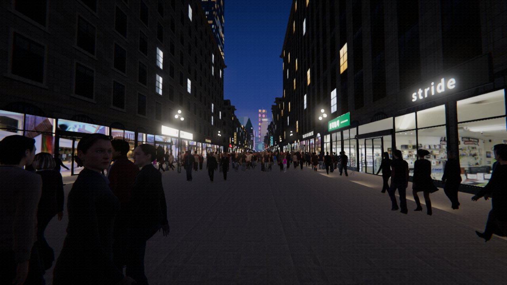
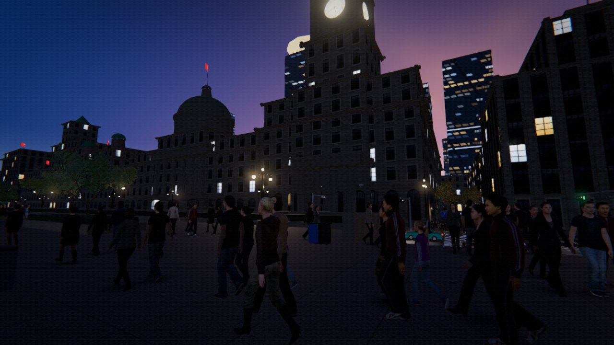
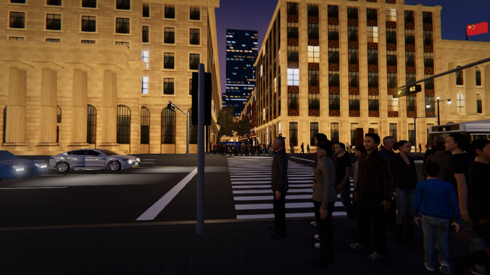
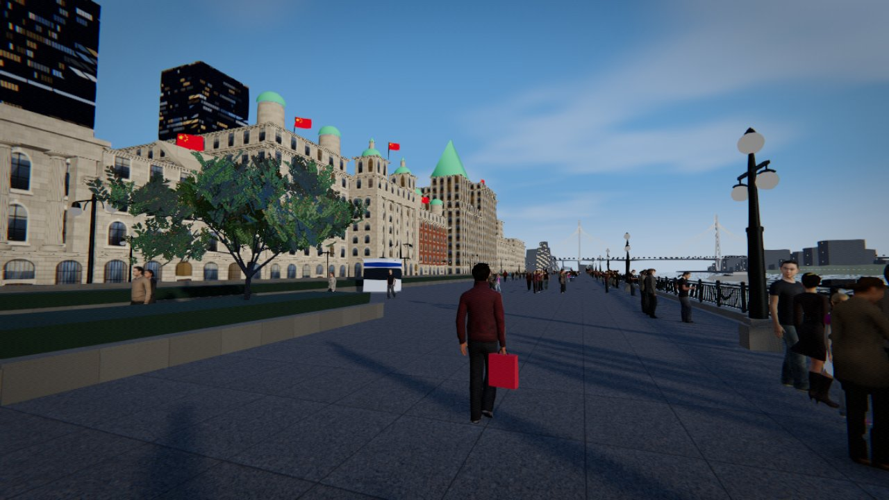
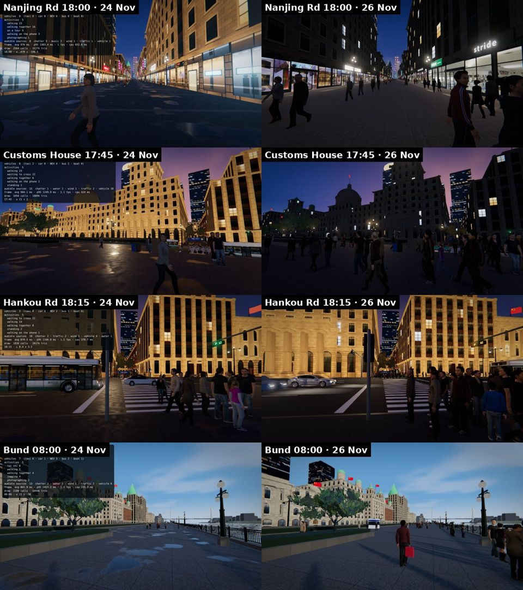

# A living city: the benchmark

The goal of the larger effort is a Bund that feels alive when it is put side by side with real footage of the same streets. This page fixes what is compared: four hero shots, the numbers measured in each, today's baseline, and provisional targets with where they come from.

## The hero shots

Each shot is a fixed camera at a fixed hour, at a person's eye height (1.68 m above the ground there), the way handheld footage is shot. They are defined once, in `src/engine/bench.js` (`HERO_SHOTS`), and used by the tool, the in-game benchmark and the tests.

| id | Place | Hour | Camera (x, y, z) | Looking at | What is in frame |
|---|---|---|---|---|---|
| `nanjing` | Nanjing Road East near Henan Road (`NJ` in `src/world/layout.js`) | 18:00 | -478, 1.83, -198.5 | -380, 6.5, -201.5 | The pedestrian street just east of the Henan Road crossing and metro Exit 7, looking east along the shopfronts and neon |
| `customs` | The promenade at the Customs House | 17:45 | 21, 4.68, 2 | -36, 13, 34 | The promenade deck in the foreground; across the road, the Customs House with its clock tower and the HSBC dome (floodlit from 18:00) |
| `hankou` | The Hankou Road crossing | 18:15 | 0.4, 1.83, 3.5 | -40, 3, -0.5 | From the foot of the promenade stair, across the zebra on Zhongshan East 1st Road and into Hankou Road |
| `morning` | The Bund at 8 am | 08:00 | 21, 4.68, -38 | -24, 12, -160 | North along the promenade in morning light: joggers, the tai chi group (until 8:15), the northern Bund's façades |

The crowd and traffic are the game's normal ones (no `?q`), and the preset is forced to **Mac M4** (`gfx=mac`: 90% resolution, medium detail, SMAA, one lamp shadow, no AO or wet reflections). At medium detail that is about 390 people across the whole map and 22 vehicles on Zhongshan East 1st Road, plus Henan Road's traffic.






## What is measured

The liveliness overlay (**L**, or `?live`) and `window.__bund.live()` return the same numbers (`src/engine/live.js`, gathered by `src/world/liveliness.js`):

- **People in view.** In the camera's frustum, not behind a building, within 330 m. Counted by how they are drawn:
  - *near*: full animated Rocketbox people.
  - *mid*: impostor cards nearer than 40 m.
  - *impostor*: cards further off.
  - The crowd, the crossing's four walkers, Old Lin and Ms. Su, and the tai chi group are all counted.
- **Vehicles in view, by type.** Taxi, car, NEV (the four new-energy lookalikes), bus and boat (the river's cruise boats).
- **Distinct activities.** The different things people within 120 m are doing, for example walking, walking together, walking on the phone, photographing, taking a selfie, looking at the view, window-shopping, waiting to cross, waiting for a bus, on a tour, jogging, tai chi, chatting and in and out of shops.
- **Audible sources.** Sound sources whose level where you stand is above about -40 dB (0.01, before the master level). They are counted by kind: chatter, music, vehicle, traffic, water, wind, clock, announcement, shop, horn, boat and voice.
- **Frame time.** Over the last 180 frames: the average and the 95th percentile, the frame rate, and the main thread's time per frame.
- **Draw calls and triangles** in the last frame.

## Running it

**On your Mac** (the game served as usual):

- Packaged build: http://localhost:8000/?bench
- `npm run dev`: http://localhost:5173/?bench

Click **Start the benchmark**. It takes about a minute and a half. Each shot settles for 4 s and is then measured for 12 s, with the frame cap off. When it finishes, the result appears on screen as JSON. **Copy the result** copies it; send that text back.

- Nothing is saved to your game while `?bench` is in the address. No calls, street moments or tips happen.
- The Mac M4 preset is used unless you add `&gfx=high` or similar.
- The result is also kept in this browser's storage (`bund-bench-shots`) and in `window.__bund.lastShots`.

The JSON gives, per shot:

- `frame`: average, p95, p99 and worst frame time in ms, and fps.
- `mainThread`: the same for the main thread's time per frame. Its `fps` is only what that thread alone would allow.
- `live`: the mean and maximum of every number above, sampled twice a second.
- `activitiesSeen` and `audibleKinds`.

A `settings` block records the preset, resolution, GPU and browser.

**Here (headless, for screenshots and the numbers):**

```bash
node tools/shot.mjs http://localhost:4174/ <outDir> hero
```

This writes `<id>.png`, `<id>-live.png` (with the overlay) and `hero.json`, against a build served by `npx vite preview --port 4174`. `window.__bund.heroShot(id)` holds one shot, `endShot()` lets go, and `runShots({ settle, measure })` runs the benchmark from the console.

## Today (26 November 2026)

Rerun on master after the night-city, e-bike, crowd and lobby work, with the same tool and settings as the first baseline below (headless Chromium, SwiftShader, Mac M4 preset, 1280×720, five samples after the shot settled). Raw numbers: `hero.json` from `node tools/shot.mjs <url> <dir> hero`.

| | Nanjing Rd 18:00 | Customs House 17:45 | Hankou Rd 18:15 | Bund 08:00 |
|---|---|---|---|---|
| People in view (near / mid / impostor) | **206** (3 / 21 / 181); **1,857** with the throng (below) | **142** (12 / 68 / 62) | **93** (8 / 68 / 17) | **239** (12 / 25 / 202) |
| Vehicles in view | 0 (pedestrian street) | 18 (taxi 5, car 8, NEV 2, bus 3) | 2–4 (taxi, NEV, bus; the signal cycle) | 20 (taxi 5, car 11, NEV 2, bus 1, boat 1) |
| Distinct activities (within 120 m) | 3–4 (walking, together, on a tour, on the phone) | 5.6 (+ waiting to cross, a tour group, standing) | 5.4 | **9** (tai chi, jogging, photographing, selfies, looking at the view, a tour...) |
| Audible kinds | **5** (chatter, music ×2, traffic, wind, Henan Rd's vehicles) | **6** (chatter, water, wind, traffic, boat, vehicles) | 6 | 6 |
| Draw calls | **1,146** (was 2,478) | 843 (was 1,678) | 873 (was 1,794) | 842 (was 2,178) |
| Triangles | 3.5 M (was 3.0 M) | 3.1 M (was 1.9 M) | 3.0 M (was 1.9 M) | 2.5 M (was 1.9 M) |

What changed since the 24th:

- **People more than doubled** in three of the four shots, and the mid tier (cards under 40 m) carries most of the extra on the Bund. Every shot is still under the provisional range, Nanjing Road most of all (206 against 600–1,500).
- **Draw calls halved** everywhere (instancing, the interiors drawn only near their block). Triangles went up with the people and the cars; Nanjing Road sits right at the 3.5 M bound, so it has no room for more full-detail people without a cheaper mid tier.
- **The Customs House at 17:45 is now dark:** the Bund's floodlights switch on at 18:00 (`engine/timeOfDay.js`), so the façades are silhouettes against the dusk. That is what the real Bund does; the reference footage for this shot should be checked for its minute.
- **The sound count was fixed** (`engine/live.js` `bedSources`). Since the recorded beds took over on the 25th, the meter still counted the synthesised wind, river and murmur that had been faded out, plus the placed talkers that had been silenced, and did not count the beds themselves. It now counts what is actually playing. The tool also waits for shop music within earshot to start before it measures (software rendering takes about 12 s to load a track).
- Nanjing Road still has few distinct activities in view: nearly everyone is walking. Window-shopping, shop doors and the payment speakers happen nearer than the camera's crowd.



## Nanjing Road's throng (26 November 2026)

The simulated crowd (`engine/crowd.js`) is a few thousand people for the whole map, and Nanjing Road's 1.5 km got a couple of hundred of them: 206 in the hero view at 18:00. The street is far busier than that, so it now has a **throng** beyond the simulated crowd (`engine/throng.js`, drawn by `world/throngView.js`, tested by `tests/throng.test.mjs`):

- **What they are:** impostor cards from the far crowd's atlas, walking straight tracks along the street east or west at 0.85-1.35 m/s with a slight weave. More than a third walk in twos and threes, and about 7% stand at the shop windows or photograph the street. Everything they do is worked out in the vertex shader from the time and a few numbers each, so the throng costs **one draw call and no per-frame work on the main thread**.
- **Where:** two stretches cut at Henan Road, so nobody walks through its traffic. Nobody walks in the trams' lanes west of Henan Road, in the metro wells, or inside a building. People fade out at the end of a stretch and come back in at the other end. Within about 15 m of the camera they fade away, because that is where the simulated crowd's full people are. They also fade out past 420-470 m.
- **How many:** at the busiest, 4,000 / 12,000 / 15,000 / 20,000 people (low / medium / high / ultra, `engine/gfx.js` `throng`), scaled by the same share of the evening as the simulated crowd. A weekday at 18:00 is about 0.69 of that, or about 0.26 people per m² on the medium preset. Rain halves it. `?throng=0` turns it off and `?throng=<n>` sets the number.
- **Result:** the hero view at 18:00 holds **1,857 people** (it held 206). Draw calls 1,110 and triangles 3.6 M, just over the 3.5 M bound, which the throng's own cards (24 k triangles) do not explain; the rest is the full crowd varying between runs.


## Full people chosen by view (26 November 2026)

**Why Nanjing Road had so few full people.** The full people (16 at medium detail) went to the nearest people within 44 m in every direction, whichever way the camera faced.

- The Nanjing Road camera stands just east of metro Exit 7 and the Henan Road crossing, where people arrive. Most of the simulated crowd near it is behind or beside it.
- In one sample, 65 people were within 44 m but only 10 were in view, and the 16 nearest were all behind the camera, 4–8 m off.
- It was not a shortage of avatar bodies (at most 25 of the 32 allowed had been made) and nobody was stuck.

**The change** (`nearRank` in `src/engine/crowd.js`, tested in `tests/crowd.test.mjs`; used by `src/world/crowdView.js`):

- Anyone within 3 m stays a full person whichever way you face, because those are the people you bump into and talk to.
- Beyond that, someone outside a cone about 29° wider each side than the view counts as three times as far.
- The ranking runs every quarter second, and at once when the view turns more than about 25°.
- The middle tier picks from the same ranked list, so it prefers people in view too.

**Full people in view** (same tool and settings, five samples per shot):

| | Nanjing Rd 18:00 | Customs House 17:45 | Hankou Rd 18:15 | Bund 08:00 |
|---|---|---|---|---|
| Before (*Today*, above) | 3 | 12 | 8 | 12 |
| After, measured on master with the change | **5.8** | **13.6** | **9.6** | **15.8** |
| People in view, after | 1,887 | 171 | 131 | 220 |
| Draw calls / triangles, after | 1,157 / 3.6 M | 829 / 3.2 M | 866 / 3.1 M | 852 / 2.6 M |

- The crowd is random from run to run; the ranking does not change where anyone walks.
- "Near" can exceed 16 because the crossing's four walkers and Old Lin and Ms. Su are full people too.
- Draw calls and triangles are in line with *Today*: the same number of full people is drawn, now mostly in view.
- Before master's other work was merged in (no throng, no middle tier), the same change took the four shots from 2 / 15 / 7 / 8 full people in view to 7.4 / 20 / 11.6 / 13.

**Turning round at the Nanjing Road spot** (play mode, two runs, measured before the merge):

| | Full people in view | People in view within 44 m | Cards in view within 20 m | Cards in view within 10 m |
|---|---|---|---|---|
| Facing east (down the street) | 9–11 | 12–18 | 0 | 0 |
| Facing west (Henan Road and the exits) | 4–9 | 20–31 | 3–7 | 0 |

Facing west, more people are in view than there are full-people slots. People behind you within about 5 m still outrank people in view beyond about 15 m: that is the 3× weighting (`NEAR_RANK.behind`), and it can be raised. The swap from card to full person on turning has not been looked at on a real screen.

## First baseline (24 November 2026)

Measured in headless Chromium with software rendering (SwiftShader), Mac M4 preset, 1280×720. The numbers below are means of five samples taken after the shot settled.

- People, vehicles, activities, sound sources, draw calls and triangles do not depend on the GPU.
- **Frame times measured here say nothing about a real machine**: about 850–980 ms a frame, or 1 fps, in software. No GPU frame rate could be measured. Those numbers have to come from the Mac.

| | Nanjing Rd 18:00 | Customs House 17:45 | Hankou Rd 18:15 | Bund 08:00 |
|---|---|---|---|---|
| People in view (near / mid / impostor) | **94** (2 / 9 / 83) | **56** (15 / 20 / 21) | **45** (7 / 31 / 7) | **30** (8 / 3 / 19) |
| Vehicles in view | 0 (pedestrian street; Henan Rd is behind the camera) | 7 (taxi 2, NEV 4, bus 1) | 1–4 (NEV, bus) | 6.6 (car 1, NEV 2.6, bus 2, boat 1) |
| Distinct activities (within 120 m) | 4.4 (walking, walking together, on a tour, on the phone, standing) | 4.2 (walking, waiting to cross, together, on the phone) | 5 (waiting to cross, walking, together, standing, on the phone) | 5 (tai chi, jogging, walking, together, photographing) |
| Audible sources | 7.8 (chatter, music ×2, traffic, wind) | 15.6 (vehicles 11, chatter, traffic, water, wind) | 8–16 (vehicles, chatter, traffic, water, wind) | 13 (vehicles 7, chatter, traffic, water, wind) |
| Draw calls | 2,478 | 1,678 | 1,794 | 2,178 |
| Triangles | 3.0 M | 1.9 M | 1.9 M | 1.9 M |

Hankou Road's vehicle and sound counts swing with the signal cycle: a red phase leaves the near lanes empty.

What stands out:

- **Too few people.** The whole map holds about 390 people at medium detail. Nanjing Road at six in the evening shows under a hundred, nearly all of them as distant cards. Only one or two were full people there, against 15 on the promenade (see *Full people chosen by view*).
- **Too few vehicles at the crossing.** Zhongshan East 1st Road shows 1–7 vehicles where a busy four-lane road at a signal would show a queue.
- **Narrow activity.** Four or five different things at once, mostly kinds of walking.
- **Nanjing Road is the heaviest view:** 2,500 draw calls and 3 M triangles before any more people are added.

## Provisional targets

These are first estimates to steer by. They should be replaced by counts made from the reference footage, frame by frame, for each hero shot. Each line says where it comes from and how sure it is.

| | Nanjing Rd 18:00 | Customs House 17:45 | Hankou Rd 18:15 | Bund 08:00 |
|---|---|---|---|---|
| People in view | 600–1,500 | 250–700 | 150–300 | 100–250 |
| Vehicles in view | 0 (pedestrian street) | 8–20 | 10–25 | 8–20 |
| Distinct activities | ≥ 8 | ≥ 8 | ≥ 6 | ≥ 6 |
| Audible sources (kinds) | ≥ 6 kinds | ≥ 6 kinds | ≥ 5 kinds | ≥ 5 kinds |
| Frame time on the Mac M4 preset | avg ≤ 16.7 ms, p95 ≤ 20 ms | same | same | same |
| Draw calls / triangles | ≤ 2,500 / ≤ 3.5 M | same | same | same |

How they were reached:

- **People: Nanjing Road.**
  - Holiday peaks of people on the whole pedestrian street at once:
    - [40,000 at 18:56 on 1 October 2024](https://m.bjnews.com.cn/detail/1727836980129521.html).
    - [32,000 at 18:00 on 31 December 2025](https://finance.sina.com.cn/jjxw/2025-12-31/doc-inhesxnp3715015.shtml).
    - [57,000](https://news.china.com/socialgd/10000169/20261002/49775342.html) and [65,000](https://i.ifeng.com/c/8wvi6DcRAVB) on 1 and 2 October 2026.
    - [17,529 at 22:00 at Qingming 2025](https://news.qq.com/rain/a/20250406A0404500).
  - Area:
    - The street is [1,033 m long and 20–28 m wide between Henan and Xizang Roads](https://www.thepaper.cn/newsDetail_forward_4488774).
    - The extension to the Bund adds [about 495 m](https://m.winshang.com/news676321.html); its width was not found, and the game uses 22 m.
    - That is about 36,000 m² in all, so a holiday peak is roughly 1 person per m².
  - No figure was found for an ordinary evening. A busy Saturday, 13 July 2024, had 189,000 visits over the day, with no peak given (reported by Sina Finance on 1 August 2024; the article's URL was not kept).
  - **Assumption:** an ordinary November evening at 0.15–0.3 people per m² (a sixth to a third of a holiday peak).
  - The view covers about 22 m × 300 m of street, which gives 1,000–2,000. The lower end of the range allows for people hidden behind others. *Low confidence: replace with footage counts.*
- **People: the Bund.**
  - People on the Bund waterfront at once:
    - [34,000 at 19:00 on Wednesday 19 August 2026, and more than 40,000 on Saturday 15 August](https://m.thepaper.cn/newsDetail_forward_33815528).
    - [43,000 at 19:40 on 1 October 2024](https://m.bjnews.com.cn/detail/1727836980129521.html).
  - Area: the promenade's length is given as anything from 1.5 to 2.6 km, and its width was not found.
  - **Assumption:** about 0.1–0.25 people per m² at 17:45 on a November weekday, over the 1,500–3,000 m² of walkable ground the Customs House view takes in.
  - The 08:00 shot is taken as about a third of the evening density (commuters, joggers, the tai chi group).
  - The Hankou crossing shot counts the zebra, both pavements and the stair foot. *Low confidence.*
- **Vehicles.**
  - Zhongshan East 1st Road went from [11 lanes to 4 (two each way) when the Bund Tunnel opened in 2010](https://m.xinminweekly.com.cn/content/9413.html). There are also [2 spare lanes for bus stops and stopping](https://www.shanghai.gov.cn/nw9822/20200906/0001-9822_361953.html).
  - No hourly traffic volume was found.
  - **Assumption:** a red-phase queue of 4–8 vehicles per lane over the 100–150 m in view, plus moving traffic on the far side. *Low confidence.*
- **Sound** (see `docs/sound.md`).
  - Shanghai's [2025 averages: road traffic 67.9 dB(A) by day, background 55.3 dB(A)](https://sthj.sh.gov.cn/cmsres/c6/c692c51cbeed428fa12ede2f6ebf56a1/3dfdcfd940cab0bce8fa57b709ac1be4.pdf). So at the roadside the traffic should sit about 12 dB over the general background, and it should fall well below it down Nanjing Road.
  - The "kinds" targets are a judgement: chatter, music, traffic, water, wind, a clock, announcements, shop doors.
- **Activities.** A judgement of what such footage typically shows beyond walking:
  - photographing the neon or Pudong, selfies, carrying shopping, eating or drinking on the move
  - tour groups, security and police patrols, cleaners
  - people waiting at the kerb, people sitting.
- **Frame time.** The Mac M4 preset exists to hold 60 fps on a Mac mini M4 (README, *Graphics settings*). The p95 bound allows the occasional long frame.
- **Draw calls.** The impostor crowd is one draw call however many people it holds, so more people need not cost more calls. The bound keeps Nanjing Road, the heaviest view today, from growing.

## Not verified

- **No GPU frame time has been measured.** The Mac run (`?bench`) supplies it. On 26 November the run was still waiting for the Mac.
- **The targets have not been checked against footage.** Counting the reference footage per shot is the next step.
- Occlusion is 2-D, against building footprints. People hidden behind other people, trees or the bus shelters still count as "in view".
