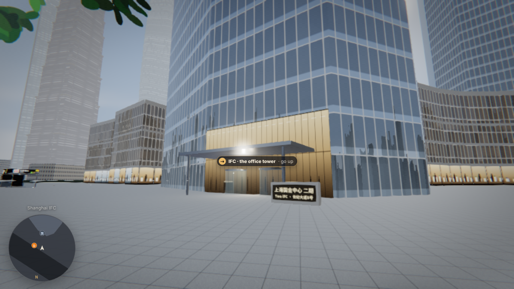
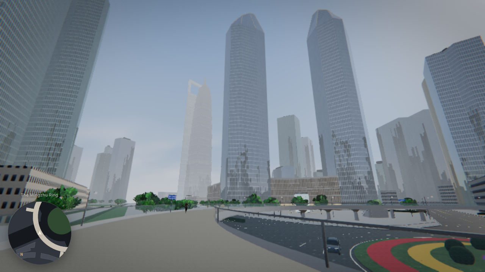
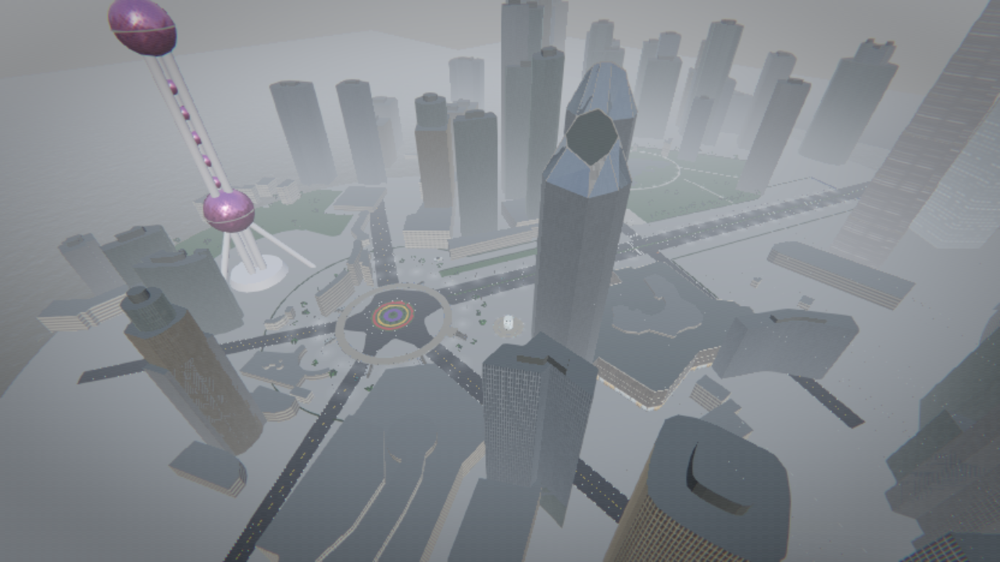

# Lujiazui (陆家嘴): the district across the river

The second walkable district. You reach it the way you would in Shanghai: Line 2, one stop from East
Nanjing Road, or a DiDi through the Yan'an East Road tunnel. Both end at street level now; IFC's
32nd floor is reached through the lobby door.

## Code

| File | What it holds |
|---|---|
| `src/world/lujiazuiOsm.js` | **Generated** from OpenStreetMap by `tools/osm/ljzosm.mjs` (do not edit): 158 building footprints with heights, the Green, its lake, the Pearl's park, the roundabout, the Mingzhu Ring, the Apple plaza and store, the metro entrances, in the game's frame. |
| `tools/osm/ljzosm.mjs`, `tools/osm/wikidata-lujiazui.json` | The generator (the `curl` for the extract is in its header) and the Wikidata heights it falls back on. |
| `src/world/facade.js` | Curtain-wall glass: `facadeGlass` (the district's towers) and `skylineGlass` (the far towers seen from the Bund). |
| `src/world/lujiazuiLayout.js` | Pure, node-tested. Reference coordinates and the game-frame transform (top comment), every position, the ground height, the collisions, the traffic routes, the signal, the exported `LJZ` positions. Registers itself with `layout.js` `movers` (ground + keep), so `layout.js`'s own ground code is untouched. |
| `src/world/lujiazuiGround.js` | The ground mesh (carriageways, pavements, lawns, paths, kerbs, guard rails, paint), sampled from the same functions the collisions use. |
| `src/world/lujiazuiBuild.js` | Structures: the ring bridge, Apple's plaza, cylinder and store, IFC (the two towers and the mall from their footprints, the crowns, the lobby, the signs), every other OSM building extruded, the metro stairwells, the Green's furniture, trees, lamps, signals, signs. |
| `src/world/lujiazuiLife.js` | Traffic (route followers) and about eleven people. |
| `src/world/lujiazui.js` | `createLujiazui`: builds lazily, shows / hides, arriving and leaving, what E does, the map, per-frame update. |
| `tests/lujiazui.test.mjs` | Walks the ground in node (stairs, ring, plaza, spiral, store, kerbs, zebras, metro, the footprints as walls, the lake). Part of `npm test`. |
| `tools/ljzwalk.mjs`, `tools/ljzcheck.mjs`, `tools/ljzground.mjs` | The browser walkthrough and screenshots; layout sanity; ground mesh size. |

Small hooks elsewhere: `skyline.js` `setNear()`, `destinations.js` `exitTo`, `ride.js` (`walkIn` on
Lujiazui), `layout.js` (two rain covers), `ui/minimap.js` (`mapExtras`, a second sheet), `ui/worldMap.js`
(bounds, labels), `engine/minimapLogic.js` (`zoneAt`), `ui/i18n.js` (area names), `main.js` (8 new lines).

## `LJZ`: positions for other modules

`import { LJZ } from './world/lujiazui.js'` (or from `lujiazuiLayout.js`, which has no three.js):
`ifcLobbyDoor` (with its outward normal), `ifcLobbyStand`, `officeLift` (the existing lift on 32F),
`kerbPickup`, `appleEntrance`, `appleCylinderDoor`, `appleStore`, `metroExits[]` (exit number, street
point, landing), `metroArrive`, `greenGate`, `greenBenches[]`, `greenLawn`, `ringStairs[]`, `ring`,
`towers`. `world.ljz.build()` forces the build; `world.ljz.here(body)`, `.zone(body)`, `.stats`.

## What is there

- **Everything is where OpenStreetMap has it.** The roundabout, the Mingzhu Ring, the five roads
  (bearings measured from OSM's ways), the junction with Middle Yincheng Road, the Apple plaza, the
  metro entrances, the Green and its lake, the Pearl's park, and every building in the district: 158
  footprints extruded to their heights (OSM's `height` or `building:levels`, else Wikidata's floors,
  else a few recalled figures, else a flagged guess; see *Fidelity*). Their outlines are the walls you
  walk into. The Pearl, Jin Mao, the World Financial Center and the Shanghai Tower keep the skyline's
  own models, moved to their OSM positions while you are in Pudong.
- **The roundabout and the Mingzhu Ring (明珠环).** A planted island (r 24.7 m), three lanes round it
  (to r 37 m), five roads in. No zebra on the roundabout: kerb-side guard rails all round, the ring
  bridge is the way across. The ring (centreline r 58.5 m, 9 m deck, 5.5 m up) is centred 13 m
  south-west of the roundabout, as OSM draws it; walkable all the way round, glass balustrades,
  five stairs down (each with a pair of escalators), the spur toward IFC and its stair toward the
  Apple plaza, wayfinding signs at each stair head.
- **Shanghai IFC.** The two towers from their OSM footprints (squares with cut corners): Two IFC, the
  north tower, 259.9 m and 56 floors, nearer the avenue; the HSBC Building, the south tower, 249.9 m
  and 58 floors (the Ritz-Carlton's eighteen top floors), south-west of it. Silvery glass with close
  mullions; each rises into a cut-crystal crown, its outline leaning in to a smaller copy whose top
  tilts toward the other tower, the edges lit at night. The mall between them is OSM's outline (its
  curved north front faces the Apple plaza): four levels of glass over shopfronts, "ifc mall" and
  上海国金中心商场 over the doors facing the cylinder and again toward the avenue, a directory totem
  (the mall, Apple, the Ritz-Carlton, Line 2). Two IFC's lobby is on the face toward Century Avenue
  (canopy, revolving doors, address stone): **E** at the door takes the lift to the 32nd floor.
- **Apple Pudong.** OSM's paved round plaza (r 17.5 m) at street level, the 13 m glass cylinder at
  its centre (twelve finless curved panels, a stainless ring, a shallow glass dome, the logo hung
  inside facing the door, which faces the ring and the Pearl; it glows after dark), the spiral glass
  stair round the glass lift down 5.6 m to the round store under the plaza (oak tables and shelving,
  a ceiling of light rings, a shopfront to the mall's lower ground, a video wall).
- **Lujiazui station.** Three stairwells at OSM's entrances 1, 4 and 6 with Shanghai Metro's mark, the station's
  name, Line 2 and Line 14 badges, exit numbers. On a landing: **E** at the way in rides one stop back
  to East Nanjing Road (¥3); **E** at the side wall goes through to the next exit.
- **The Central Green.** Lawn, a lake, a loop path with benches and lamps, a white membrane canopy,
  a tree belt, the park's name on a boulder at the corner gate, a jogger and strollers.
- **The skyline up close.** The Pearl where it always was; Jin Mao, the World Financial Center and
  the Shanghai Tower moved to their real offsets from it while you are in Pudong; IFC; named and
  generic towers on the blocks around.
- **Traffic and street.** Taxis, private cars and the NEV lookalikes on routes through the roundabout
  (anticlockwise, giving way on entry), along Century Avenue and on Yincheng Road; a signalled
  junction with two zebras you can cross; lane paint, kerbs, white guard rails, street lamps, road-name
  plates, a ride-hailing point at IFC's kerb (**E**: a car back to the Bund).

## Fidelity notes

**Surveyed: OpenStreetMap.** Since this session's network was opened, the district is built from an
OSM extract (API `map` call, bbox 121.4920,31.2330 – 121.5060,31.2440; data © OpenStreetMap
contributors, ODbL 1.0) through `tools/osm/ljzosm.mjs`. The frame: x = 640 + (lon − 121.49527) ×
95190, z = −42 − (lat − 31.2419) × 110860 (the Pearl's OSM centroid at the skyline's PEARL).

| What | From |
|---|---|
| Building footprints (158), names | OSM ways tagged `building` / `building:part` (outlines with parts are drawn by their parts unless they carry their own height) |
| Heights: 31 from OSM `height`, 35 from `building:levels` (× 3.7 m, × 4.6 m for malls) | OSM |
| 2 from Wikidata floors (Bank of Shanghai HQ 46, World Finance Tower 43, × 4.3 m) | a Wikidata `wikibase:box` query (P2048 / P1101) over the same box, `tools/osm/wikidata-lujiazui.json` |
| 4 recalled (One Lujiazui 269 m, Super Brand Mall 50 m, IFC Mall 30 m, GALA MALL 24 m) | memory; marked `hs: 'recalled'` in the data |
| **88 guessed** | no height anywhere: a deterministic guess from the footprint's size and whether it is in the financial core (office towers 95–170 m, apartments 70–110 m, small blocks 8–40 m); marked `g: 1`. Most are secondary buildings; some real towers among them will be the wrong height |
| Roundabout, island, ring, Apple plaza and store, Green, lake, Pearl's park, metro entrances | OSM (circles fitted to the roundabout's ways and the ring's footway) |
| Arm bearings, widths, Century Avenue's axis offset, the Yincheng junction | measured from OSM's carriageways; the arms are still drawn straight, the avenue as one 34 m carriageway |
| Ritz-Carlton in the south tower | travel listings (web search); OSM names the south tower the HSBC Building |
| Apple's cylinder (13 m, r 5 m, the rebuild) | Eckersley O'Callaghan; Michael Steeber (web search) |

Still approximate:

- Roads are straight arms with flared mouths, not OSM's carriageway geometry: the slip roads, the
  Yan'an Road and Middle Yincheng Road tunnels and Century Avenue's service roads are not drawn.
  Middle Yincheng Road is drawn as a signalled surface junction square to the avenue.
- OSM shows many stairs and escalators off the ring, most on its south-west; the game has five
  straight stairs and the spur. The spur's stair lands about 40 m from the plaza.
- Facades are generic per kind (four kinds of glass, three of block) chosen by OSM's material tag,
  height and a hash: they are not the buildings' real facades. The IFC crowns' shape is from memory.
- Super Brand Mall's sign is placed on its face toward the roundabout; no other building is named.
- The store under the plaza is drawn round (r 16.2 m) inside OSM's store outline.
- The game's Bund runs due north-south; this district is laid out to true north, so the two halves
  differ by the few degrees the real Bund is turned.

## Arriving and leaving

- Metro (`world/metro.js`, unchanged): `arriveAt('lujiazui', { method: 'metro' })` now lands you on
  Exit 6's landing. DiDi (`rideFlow.finish`): Lujiazui is `walkIn`, so every ride there ends at
  IFC's kerb (before, only a ride to an appointment walked in; otherwise a card and a ride back).
- Appointments: the invitation a ride arrived for is remembered, and the lobby door passes it (or one
  due within two hours) to `dests.arrive`, whose scene marks it kept when it ends, as before. Note the
  old card path marked an appointment kept on arrival; now you have to go up.
- `tools/destwalk.mjs` and `tools/p3walk.mjs` expect the old behaviour (straight to 32F); their
  Lujiazui steps need updating to go through the lobby door.
- The phone's DiDi app still sends its car to the Bund pick-up point; from Lujiazui use the
  ride-hailing point at IFC's kerb (a fade, the fare, the time), or the metro.

## Cost

Nothing is built, drawn or simulated while you are on the Bund; the fonts for the signs are
requested at boot, and the district is built the first time you arrive (0.7 to 1.8 s under software
GL, during the fade). While you are in Pudong the Bund's own groups (interiors, traffic, people,
trees: about 1,500 meshes) are hidden and restored when you leave; its façades, the promenade and the
river stay drawn. Measured under SwiftShader at quality step 4 (not on a Mac mini M4):

- District (with OSM's 158 buildings): about 390 meshes in the group including 12 cars and 11 people,
  255,000 triangles of static geometry (ground 27,400; 18,700 leaf cards), 146 lamp sources feeding
  the shared pool of 6 real lights; built in about 1.8 s under SwiftShader.
- A frame from the Apple plaza at 1 pm: about 230 draw calls, 175,000 triangles; at dusk about 330
  draw calls. The facade shader is one per glass kind (seven programs in all, shared).
- Each visible person is a full Rocketbox avatar; they are drawn within 95 m only.
