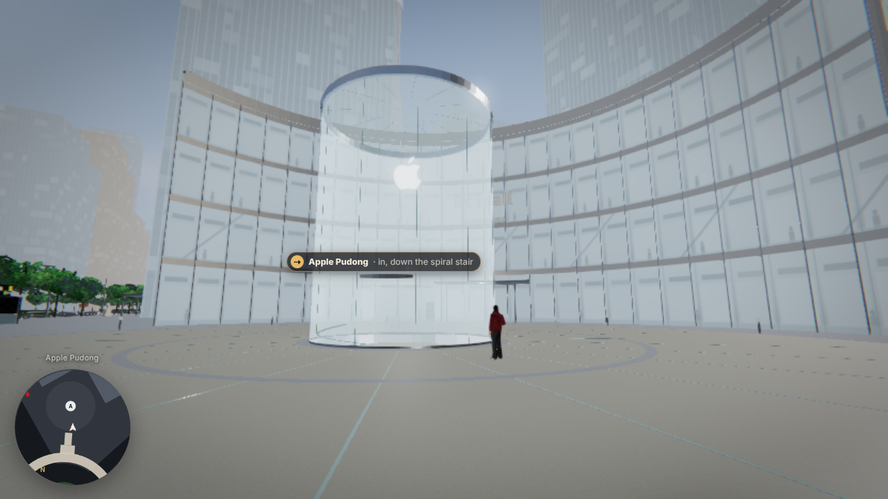
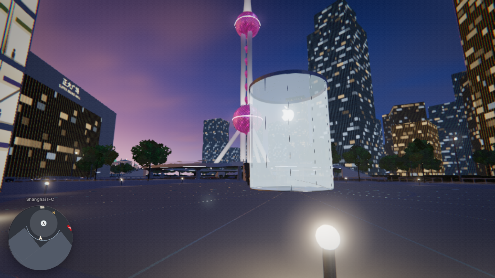

# Lujiazui (陆家嘴): the district across the river

The second walkable district. You reach it the way you would in Shanghai: Line 2, one stop from East
Nanjing Road, or a DiDi through the Yan'an East Road tunnel. Both end at street level now; IFC's
32nd floor is reached through the lobby door.

## Code

| File | What it holds |
|---|---|
| `src/world/lujiazuiLayout.js` | Pure, node-tested. Reference coordinates and the game-frame transform (top comment), every position, the ground height, the collisions, the traffic routes, the signal, the exported `LJZ` positions. Registers itself with `layout.js` `movers` (ground + keep), so `layout.js`'s own ground code is untouched. |
| `src/world/lujiazuiGround.js` | The ground mesh (carriageways, pavements, lawns, paths, kerbs, guard rails, paint), sampled from the same functions the collisions use. |
| `src/world/lujiazuiBuild.js` | Structures: the ring bridge, Apple's plaza, cylinder and store, IFC (towers, the 85 m block, the podium and its curved glass front), the metro stairwells, the Green's furniture, trees, the towers around, lamps, signals, signs. |
| `src/world/lujiazuiLife.js` | Traffic (route followers) and about eleven people. |
| `src/world/lujiazui.js` | `createLujiazui`: builds lazily, shows / hides, arriving and leaving, what E does, the map, per-frame update. |
| `tests/lujiazui.test.mjs` | Walks the ground in node (stairs, ring, court, spiral, store, kerbs, zebras, metro, lake). Not yet in `npm test` (package.json was off limits): run `node tests/lujiazui.test.mjs`. |
| `tools/ljzwalk.mjs`, `tools/ljzcheck.mjs`, `tools/ljzground.mjs` | The browser walkthrough and screenshots; layout sanity; ground mesh size. |

Small hooks elsewhere: `skyline.js` `setNear()`, `destinations.js` `exitTo`, `ride.js` (`walkIn` on
Lujiazui), `layout.js` (two rain covers), `ui/minimap.js` (`mapExtras`, a second sheet), `ui/worldMap.js`
(bounds, labels), `engine/minimapLogic.js` (`zoneAt`), `ui/i18n.js` (area names), `main.js` (8 new lines).

## `LJZ`: positions for other modules

`import { LJZ } from './world/lujiazui.js'` (or from `lujiazuiLayout.js`, which has no three.js):
`ifcLobbyDoor` (with its outward normal), `ifcLobbyStand`, `officeLift` (the existing lift on 32F),
`kerbPickup`, `appleEntrance`, `appleCylinderDoor`, `appleStore`, `metroExits[]` (exit number, street
point, landing), `metroArrive`, `greenGate`, `greenBenches[]`, `greenLawn`, `ringStairs[]`, `ring`,
`towers`. `world.ljz.build()` forces the build; `world.ljz.here(body)`, `.zone(body)`, `.stats`.

## What is there

- **The roundabout and the Mingzhu Ring (明珠环).** A planted island, about four lanes round it, five
  roads in. No zebra anywhere on the roundabout: kerb-side guard rails all round, and the ring bridge
  is the way across, as in life. The ring is walkable all the way round at 5.5 m, 9 m wide, glass
  balustrades; four stairs (each drawn with a pair of escalators beside it) down to the pavements
  between the roads, and a wide spur toward IFC with its own stair down to the edge of the Apple plaza.
  Wayfinding signs at each stair head.
- **Shanghai IFC.** Laid out in Century Avenue's frame: the north tower (259.9 m, offices) on the
  avenue, the south tower (249.9 m; the Ritz-Carlton's eighteen top floors) behind it to the south-west,
  and an 85 m block behind and between them. Both towers are square with notched corners, silvery
  glass with close vertical mullions (they read as fine stripes by night), and the cut-crystal crown
  with lit edges. The mall's podium is four levels (26 m): shop windows along the avenue and the ring
  road, glass and stone bands above, and, round the Apple plaza, a concave full-height glass front
  (30 m radius about the cylinder, 148° of arc) showing the lit atrium behind, with stainless mullions
  every 3 m and stone floor edges. "ifc mall" and 上海国金中心商场 over its doors (which face the
  cylinder) and again on the avenue corner; a directory totem on the plaza (the mall, Apple, the
  Ritz-Carlton, Line 2). The north tower's lobby on Century Avenue (canopy, revolving doors, address
  stone): **E** at the door takes the lift to the 32nd floor (the existing `dests.arrive`); the lift
  there now comes back down to the lobby.
- **Apple Pudong.** A pale granite plaza at street level (24 m radius, darker bands at the sill, halfway
  and at the edge, flush with the pavement; bollard lights round it, open toward the roundabout), and
  at its centre the 13 m glass cylinder (5 m radius): twelve curved panels butted glass to glass with
  no fins or fittings, a stainless ring round the top, a shallow glass dome of twelve panels meeting a
  glass disc, the white logo hung inside it facing the door and the Pearl, which faces the roundabout.
  It glows after dark. Inside, the spiral glass stair (36 treads, 400°) round the glass lift core goes
  down 5.6 m to a round store under the plaza (19 m radius): pale stone floor, twelve oak tables, oak
  shelving round the wall, a white ceiling with rings of light, a glass shopfront to the mall's lower
  ground at the back, a video wall with oak cubes before it. All of it walked, not faded.
- **Lujiazui station.** Three stairwells (Exits 1, 2, 6) with Shanghai Metro's mark, the station's
  name, Line 2 and Line 14 badges, exit numbers. On a landing: **E** at the way in rides one stop back
  to East Nanjing Road (¥3); **E** at the side wall goes through to the next exit.
- **The Central Green.** Lawn, a lake, a loop path with benches and lamps, a white membrane canopy,
  a tree belt, the park's name on a boulder at the corner gate, a jogger and strollers.
- **The skyline up close.** The Pearl where it always was; Jin Mao, the World Financial Center and
  the Shanghai Tower moved to their real offsets from it while you are in Pudong; IFC; named and
  generic towers on the blocks around.
- **Traffic and street.** Taxis, private cars and the NEV lookalikes on routes through the roundabout
  (anticlockwise, giving way on entry), along Century Avenue and on Yincheng Road; a signalled
  junction with two zebras you can cross; lane paint, kerbs, white guard rails, street lamps, road-name
  plates, a ride-hailing point at IFC's kerb (**E**: a car back to the Bund).

## Fidelity notes

**No map data or reference page could be fetched.** The session's egress proxy refused every map and
reference host tried (overpass-api.de, nominatim.openstreetmap.org, api.openstreetmap.org,
en.wikipedia.org, www.wikidata.org; in the later session also pcparch.com, eocengineers.com,
skyscrapercenter.com, macrumors.com, substack.com), so only web-search snippets were available. There
are no surveyed footprints here. What the layout rests on:

| Fact | Value used | Source |
|---|---|---|
| Ring bridge: ends, diameter, deck | 31°14′24.19″N 121°29′43.80″E and 31°14′23.99″N 121°29′48.05″E; ca. 110 m; deck 9 m | a web-search snippet of Structurae's entry (the page itself not opened) |
| Ring bridge height | about 5.5 m | web-search snippet (Komoot) |
| IFC position; tower heights | about 31.2385 N, 121.497 E; 259.9 m (north) and 249.9 m (south) | web-search snippets (Wikipedia infobox, CTBUH Skyscraper Center) |
| IFC's third block | 85 m, "behind and between the two towers" | web-search snippet (Wikipedia); KONE gives 260 / 250 / 85 m |
| IFC podium | four levels of retail | web-search snippet (Pelli Clarke Pelli's project page) |
| Ritz-Carlton Shanghai, Pudong | the top 18 floors of the south tower (Flair on 58F) | web-search snippets (several travel / hotel listings; one outlier disagrees) |
| HSBC | **contested**: one source puts its China HQ in the north tower, a 2010 report in 22 floors of the south tower, so no HSBC mark is shown | web-search snippets |
| Mall and metro | the mall's LG2 links directly to Lujiazui station (Line 2) | web-search snippets (mall guides) |
| Apple: where | No. 1, IFC Mall, 8 Century Avenue; opened 10 July 2010; the store is under the plaza, entered by the cylinder | web-search snippets (MacRumors forum, a store database) |
| Apple: the cylinder | 13 m high, 5 m radius, twelve curved laminated panels; originally on glass fins, since the rebuild with no fins or seam fittings, a stainless ring and twelve slightly curved roof panels meeting a glass disc; the stair cantilevers from an inner glass drum; architect Bohlin Cywinski Jackson, glass Eckersley O'Callaghan | web-search snippets (Eckersley O'Callaghan's project page; Michael Steeber, "Best in glass: Apple Pudong") |
| Apple: the reflecting pool | ringed the cylinder until the rebuild, removed then; what replaced it is not known, so the plaza is plain granite | web-search snippet (Steeber) |
| Pearl, Jin Mao, SWFC, Shanghai Tower positions | see the layout file's header | recalled published coordinates, not re-checked online |
| Line colours | Line 2 `#82BF25` (as elsewhere in the game), Line 14 `#827A04` | recalled from Wikipedia's palette; not an official spec |

Everything else is from memory of the place and is **approximate**:

- The five roads' bearings and widths; Century Avenue is drawn at bearing 114.7° (derived from the
  ring's centre and Jin Mao's position), 32 m of carriageway with a planted median.
- Yincheng Middle Road is drawn square to the avenue; really it crosses at an angle.
- Where exactly IFC's two towers, the 85 m block, the podium and the Apple plaza sit on their block:
  the towers are on the avenue and diagonally behind it to the south-west, the plaza in the block's
  corner toward the roundabout, the podium wrapping it on two sides. The tower plans (square, 50 m,
  4.2 m corner notches) and the crown's shape are from memory; the concave glass front round the plaza
  is a reading of photographs as remembered, not a survey, and its radius and height are estimates.
  The Ritz-Carlton is named on the plaza's directory, not on the tower. The mall has no interior and
  its doors do not open (the atrium behind the glass is a painted texture). The shop windows carry no
  brands.
- Apple: the store's real plan and size were not found; it is drawn round, 19 m in radius, one level
  5.6 m under the plaza. The plaza's paving pattern, the bollards and the totem are invented. The
  cylinder's door is drawn as a curved leaf slid aside. "Today at Apple" on the video wall is the
  store's own programme name, the only brand text added.
- Metro exits: there are three, numbered 1, 2 and 6, placed plausibly (toward the Pearl, on the
  avenue's north side, at IFC). The real station has more exits and Exit 6 connects under ground into
  the mall; the numbering against real positions is unverified.
- The Central Green is about 6.3 ha here (really about 10 ha), set about 440 m east of the roundabout
  (really nearer 370 m), a rectangle in the avenue's frame with a simplified lake. The row of towers
  between it and the avenue, and Lujiazui Ring Road running round it, are simplified: the ring road's
  loop round the park is not drawn. The old Chen Guichun house is not there.
- Super Brand Mall and the "Bank of China Tower" are massing with a name, not likenesses. The
  Shangri-La, Aurora and Citigroup towers on the river side are not individually modelled.
- The ring's stairs: number, positions and the escalators are schematic. The escalators are drawn but
  do not move (you walk them as stairs). The real Oriental Floating Court deck and the long elevated
  walkways on to the three supertalls are reduced to one spur and its stair.
- The Pearl's park is a fenced lawn with trees round the existing tower model; its base buildings are
  not modelled. You cannot walk to the Pearl, Jin Mao, SWFC or the Shanghai Tower: the walkable area
  ends at hedges and a hoarding (Century Avenue is walkable to about 560 m from the roundabout).
- From the 32nd-floor office (which keeps its old position near the Pearl, where the far skyline put
  IFC) the view is the far skyline as before, not this district.
- The game's Bund runs due north-south; this district is laid out to true north from the Pearl, so the
  two halves of the map differ by the few degrees the real Bund is turned.

## Arriving and leaving

- Metro (`world/metro.js`, unchanged): `arriveAt('lujiazui', { method: 'metro' })` now lands you on
  Exit 6's landing. DiDi (`rideFlow.finish`): Lujiazui is `walkIn`, so every ride there ends at
  IFC's kerb (before, only a ride to an appointment walked in; otherwise a card and a ride back).
- Appointments: the invitation a ride arrived for is remembered, and the lobby door passes it (or one
  due within two hours) to `dests.arrive`, whose scene marks it kept when it ends, as before. Note the
  old card path marked an appointment kept on arrival; now you have to go up.
- `tools/destwalk.mjs` and `tools/p3walk.mjs` expect the old behaviour (straight to 32F); their
  Lujiazui steps need updating to go through the lobby door.
- The phone's DiDi app still sends its car to the Bund pick-up point; from Lujiazui use the
  ride-hailing point at IFC's kerb (a fade, the fare, the time), or the metro.

## Cost

Nothing is built, drawn or simulated while you are on the Bund; the fonts for the signs are
requested at boot, and the district is built the first time you arrive (0.7 to 1.8 s under software
GL, during the fade). While you are in Pudong the Bund's own groups (interiors, traffic, people,
trees: about 1,500 meshes) are hidden and restored when you leave; its façades, the promenade and the
river stay drawn. Measured under SwiftShader at quality step 4 (not on a Mac mini M4):

- District: about 380 meshes in the group including 12 cars and 11 people, 228,000 triangles of
  static geometry (ground 25,000; 15,800 leaf cards), 129 lamp sources feeding the shared pool of 6
  real lights.
- A frame looking down the west road at 1 pm: 148 draw calls, 207,000 triangles. At dusk from the
  Green: 153 draw calls, 144,000 triangles. (Before the Bund's groups were hidden: 1,800 draw calls.)
- Each visible person is a full Rocketbox avatar; they are drawn within 95 m only.
