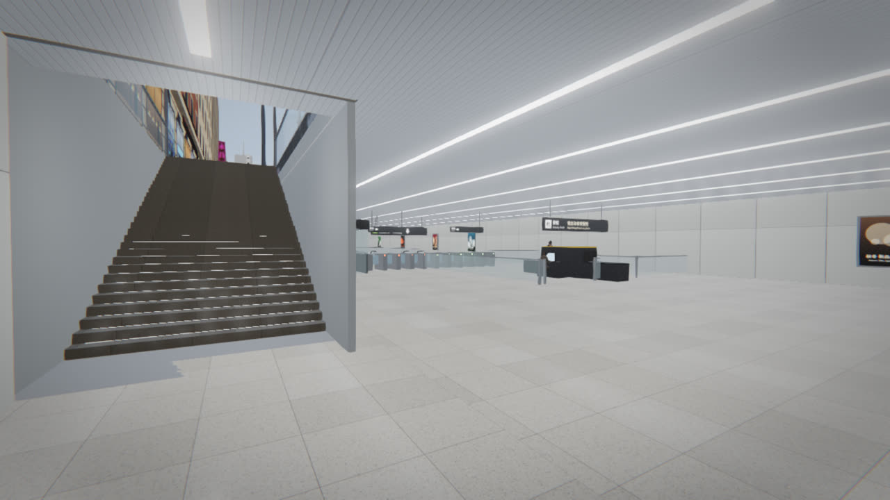
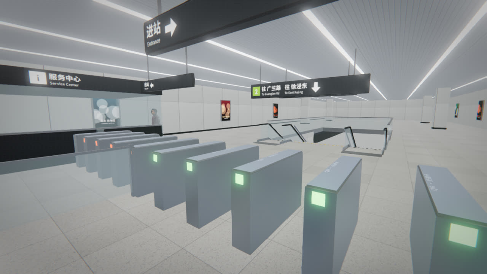
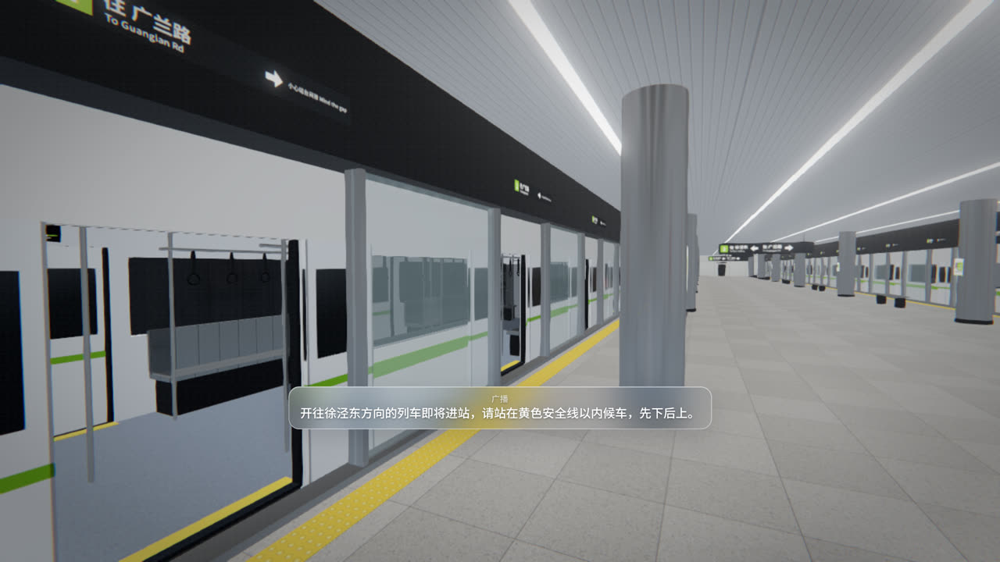
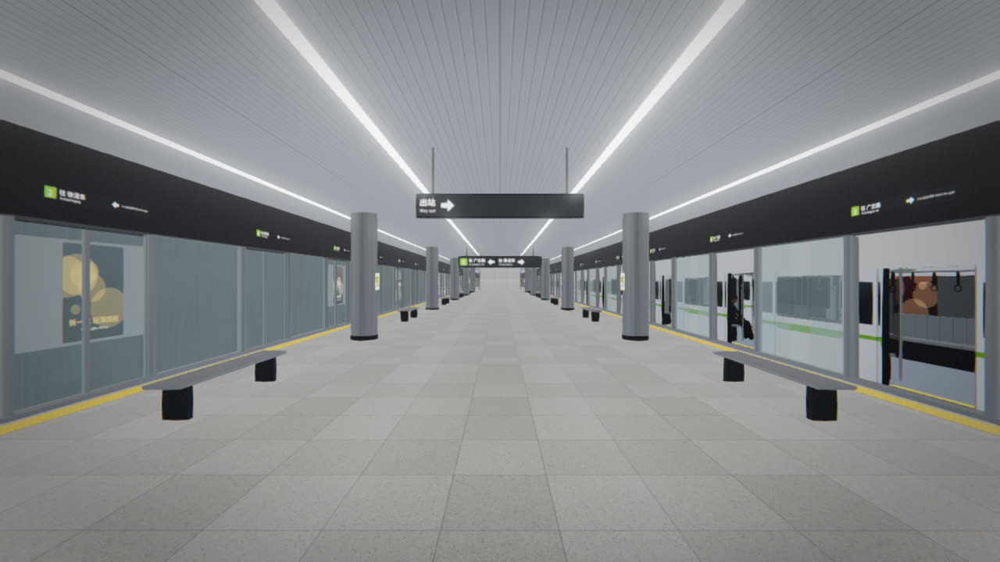
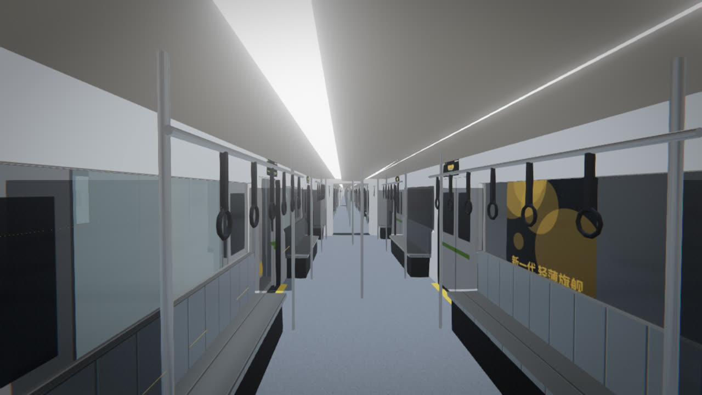
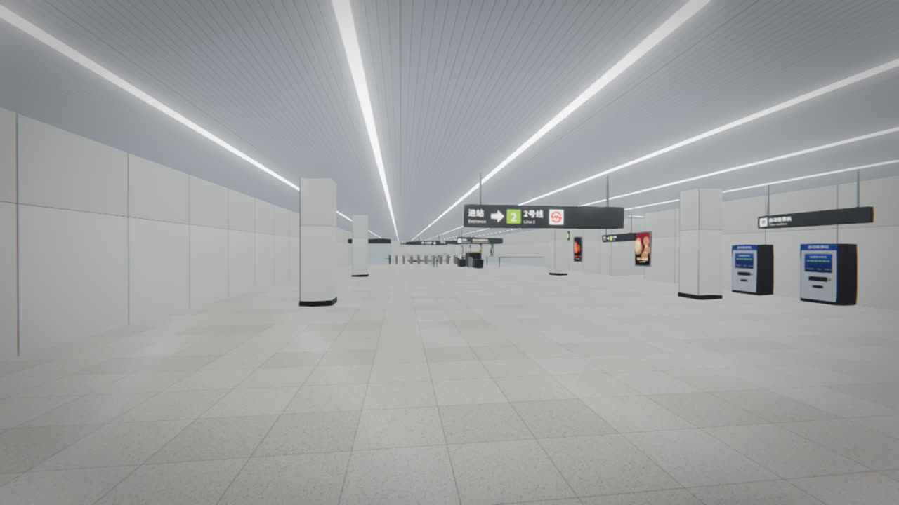

# Metro Line 2: East Nanjing Road ⇄ Lujiazui

Two stations you can walk, and the line between them, with trains that run to a timetable.

## Where the code is

| | |
|---|---|
| `src/world/metroLayout.js` | the plan (pure, node-tested): both stations from one template in a local frame (a along the platform, p across), floors, walls and furniture as boxes, the gates, security, escalators, screen-door openings; the movement "mover" (ground and keep-inside) |
| `src/engine/metroLine.js` | the line (pure, node-tested): the centreline (sampled every metre), the two tracks, the dip under the river, the trips (accelerate, run, brake, 30 s dwell, doors), the timetable, the next stop |
| `src/world/metroBuild.js` | the fabric: concourse, gates, X-ray, ticket machines, service centre, signs, escalators and stair, platform, screen doors, track, the tunnels |
| `src/world/metroTextures.js` | canvas textures: stone, panels, ceiling, wayfinding, the Line 2 strip map, screen-door headers, door markings, posters, the train's screens, the Alipay transit code |
| `src/world/metroTrain.js` | the trains: 8 A-type cars, instanced across a few slots; doors, cabs, gangways, benches, poles and straps, the screens over the doors |
| `src/world/metroFolk.js` | people: commuters in (security with a bag, gates, escalator, waiting at the door markings, boarding), people getting off, riders (sat on the benches or standing), staff |
| `src/world/metro.js` | runtime: what's drawn, the trains carrying you, gates (Alipay QR overlay, fare on the way out), security, announcements, sound, the underground light; Lujiazui is built in the background while you ride east |
| `src/engine/metroAudio.js` | procedural sound: HVAC bed, escalators, inverter whine, wheel roar, piston wind, brakes, rail joints, gate beep, door chime, reverb per space |
| `tests/metro.test.mjs`, `tests/metroAudio.test.mjs` | node tests; `tools/metrowalk.mjs` walks the whole trip in a browser; `tools/metroshots.mjs` takes pictures |

## Real and approximate

- **Real:** both are island platforms on Line 2 with full-height screen doors, one stop apart, the line under the Huangpu between them; doors open on the left; Line 2's stations and termini on the maps and screens; the exits used (East Nanjing Road 7 and 2 at Henan Road; Lujiazui 6, 4 and 1 at OpenStreetMap's entrances); tap-in/tap-out with a QR code, the fare for one stop (¥3); bags through the X-ray, people without bags walking past; the escalator reminder and the platform announcements in Mandarin then English.
- **Approximate:** the stations' plans, depths and furniture are a standard Shanghai fit-out, not the real drawings; the tunnel follows a smooth curve; the headway is a steady minute (real: about 2–5); a train takes about 90 s between them (real: about 2.5 min) at the same top speed.

## Playing it

- Trains run from about 5:30 am to 11 pm (game time). Outside those the entry gates refuse you; the exit gates always let you out. From about 23:15 to 5:15 the shutters at the ways in are down (never on you: they drop once you're out).
- How many people: `busyAt(minute)` in `world/metroFolk.js`, Shanghai's two peaks (about 8:15 and 18:00), a quiet middle of the day, thinning after 21:30. More people are drawn in the rush (each is a dozen draw calls).
- Inside the cars, as on Lines 1, 2 and 10's newer trains: over every door a screen (本站 / 下一站, the station, the doors' side) and a strip map of the whole line, the stations passed dimmed, this station red and blinking at a platform, the next one green and blinking between stations, interchanges marked; printed line maps above the windows.
- With something in a bag (an item from JD or Taobao that you carry), security holds you until you put it on the belt (E at the belt) and pick it up at the far end.
- Lujiazui's Exit 1 (by the Pearl) is a long passage: E at its landing, or at the passage door at the concourse's west end.

## Pictures

